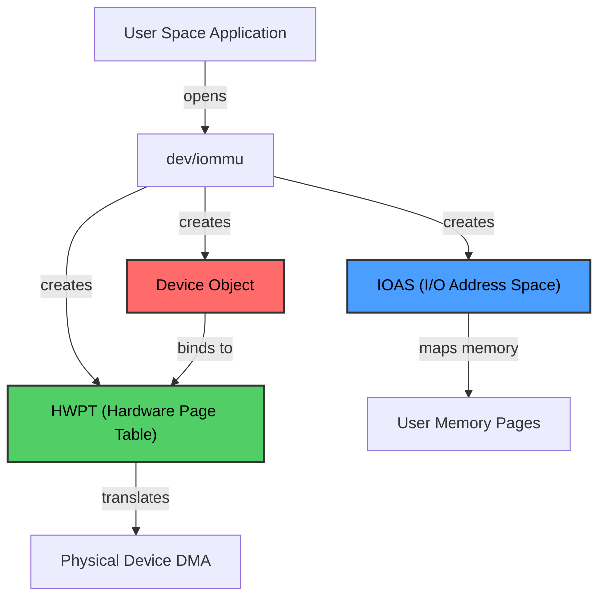
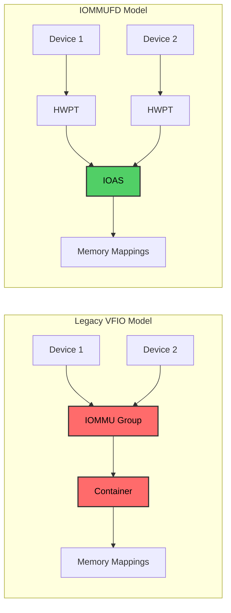
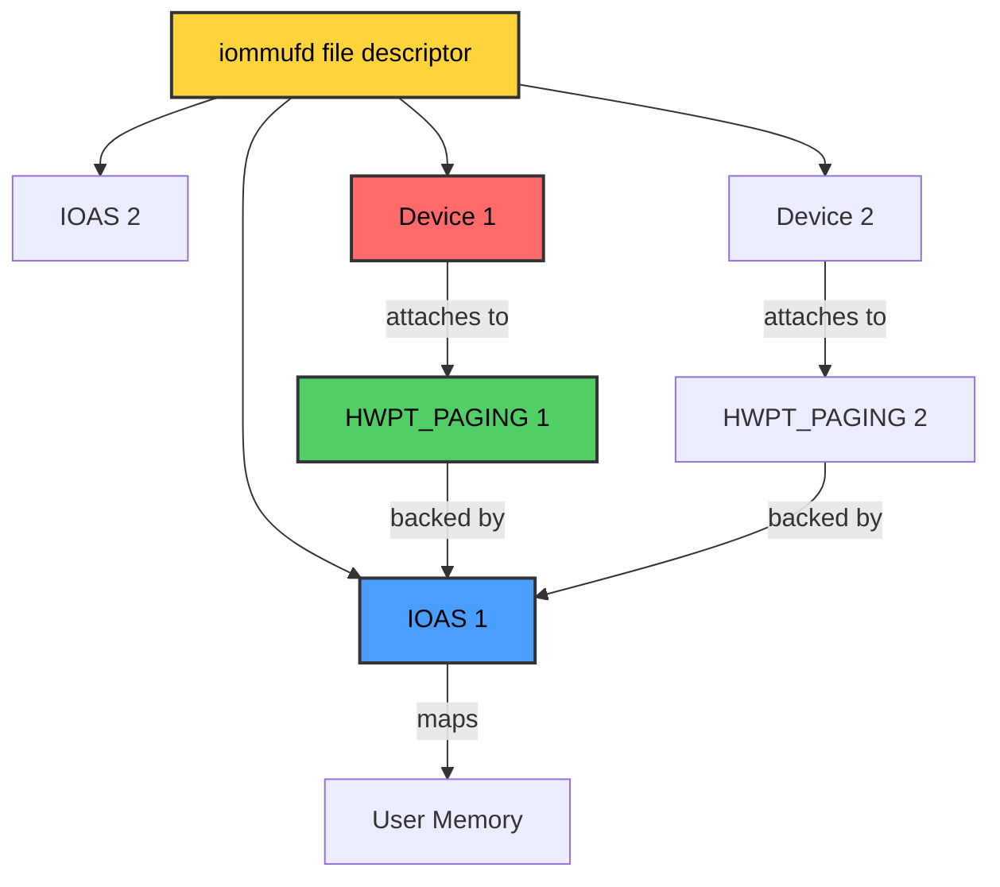
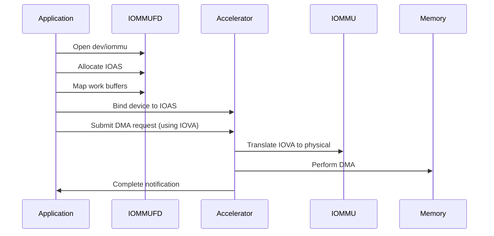
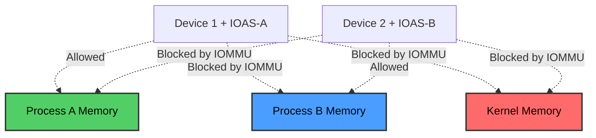

# IOMMUFD: Modern User Space Device Access

## What is IOMMUFD?

IOMMUFD is a Linux kernel user-space API introduced in kernel 6.2 for
controlling the IOMMU (Input/Output Memory Management Unit) subsystem. It
provides a generalized, device-centric interface for managing I/O address spaces
and enabling user-space applications to safely access hardware devices with DMA
capabilities.

IOMMUFD is designed to be:

- **Universal**: Consumable by any driver that needs to expose DMA to user space
- **Modern**: A replacement for the legacy VFIO container model
- **Flexible**: Supporting both simple device pass-through and complex
  virtualization scenarios
- **Secure**: Providing hardware-enforced isolation through the IOMMU

## Key Concepts and Objects

IOMMUFD exposes several object types that work together to manage device access
and I/O address spaces:



### IOAS (I/O Address Space)

An **IOAS** (I/O Address Space) represents a mapping between I/O Virtual
Addresses (IOVA) and physical memory. It allows user-space applications to map
and unmap their memory into address ranges that devices can access via DMA.

Key characteristics:

- Replaces the VFIO container concept
- Multiple devices can share the same IOAS
- Memory mappings are reference-counted (single-pin optimization)
- Supports fine-grained locking for multi-threaded operations

### HWPT (Hardware Page Table)

A **HWPT** represents the actual hardware I/O page tables maintained by the
IOMMU. There are two types:

1. **HWPT_PAGING**: Managed by the kernel IOMMU driver, translating IOVAs to
   physical addresses
2. **HWPT_NESTED**: Managed by user space, enabling nested translation for
   virtualization (e.g., guest virtual → guest physical → host physical)

### Device Objects

- **DEVICE**: Represents a physical device bound to iommufd by an external
  driver (like VFIO)
- **VDEVICE**: Represents a virtual device instance in a VM, used with
  virtualization extensions

### Additional Objects

- **FAULT**: A software queue for reporting I/O page faults from devices
  supporting PRI (Page Request Interface)
- **VIOMMU**: Represents a slice of the physical IOMMU shared with a VM,
  including hardware virtualization features
- **VEVENTQ**: A queue for reporting IOMMU events to virtual machines

### PASID Support

IOMMUFD provides comprehensive support for PASID (Process Address Space
Identifier) and Shared Virtual Addressing (SVA), enabling multiple processes to
share a single device with hardware-enforced isolation. For detailed information
on PASID and SVA, see [PASID and Shared Virtual Addressing](./pasid-sva.md).

## Architecture

### Device-Centric Design

Unlike the legacy VFIO container model which was group-centric, IOMMUFD uses a
device-centric approach:



This design allows:

- Individual device management without explicit group handling
- Flexible sharing of I/O address spaces between devices
- Simplified API for driver developers

### Object Relationships

The typical object hierarchy in IOMMUFD:



## User Space API

The IOMMUFD API is accessed through the `/dev/iommu` character device using
`ioctl` commands.

### Opening IOMMUFD

```c
#include <linux/iommufd.h>
#include <sys/ioctl.h>

int iommu_fd = open("/dev/iommu", O_RDWR);
if (iommu_fd < 0) {
    perror("Failed to open /dev/iommu");
    return -1;
}
```

### Creating an IOAS

```c
struct iommu_ioas_alloc alloc_req = {
    .size = sizeof(alloc_req),
    .flags = 0,
};

if (ioctl(iommu_fd, IOMMU_IOAS_ALLOC, &alloc_req) < 0) {
    perror("Failed to allocate IOAS");
    return -1;
}

uint32_t ioas_id = alloc_req.out_ioas_id;
```

### Mapping Memory into IOAS

```c
// Allocate and prepare user space buffer
size_t buffer_size = 4096;
void *buffer = mmap(NULL, buffer_size, PROT_READ | PROT_WRITE,
                    MAP_PRIVATE | MAP_ANONYMOUS, -1, 0);

// Map the buffer into IOAS
struct iommu_ioas_map map_req = {
    .size = sizeof(map_req),
    .flags = IOMMU_IOAS_MAP_READABLE | IOMMU_IOAS_MAP_WRITEABLE,
    .ioas_id = ioas_id,
    .user_va = (uint64_t)buffer,
    .length = buffer_size,
    .iova = 0,  // Let kernel choose IOVA
};

if (ioctl(iommu_fd, IOMMU_IOAS_MAP, &map_req) < 0) {
    perror("Failed to map memory");
    return -1;
}

uint64_t iova = map_req.iova;  // Device will use this address
```

### Binding a Device

```c
// Assuming device_fd is a VFIO device file descriptor
struct vfio_device_bind_iommufd bind_req = {
    .argsz = sizeof(bind_req),
    .flags = 0,
    .iommufd = iommu_fd,
};

if (ioctl(device_fd, VFIO_DEVICE_BIND_IOMMUFD, &bind_req) < 0) {
    perror("Failed to bind device to iommufd");
    return -1;
}

uint32_t dev_id = bind_req.out_devid;

// Attach device to IOAS
struct vfio_device_attach_iommufd_pt attach_req = {
    .argsz = sizeof(attach_req),
    .flags = 0,
    .pt_id = ioas_id,
};

if (ioctl(device_fd, VFIO_DEVICE_ATTACH_IOMMUFD_PT, &attach_req) < 0) {
    perror("Failed to attach device to IOAS");
    return -1;
}
```

### Unmapping and Cleanup

```c
// Unmap memory
struct iommu_ioas_unmap unmap_req = {
    .size = sizeof(unmap_req),
    .ioas_id = ioas_id,
    .iova = iova,
    .length = buffer_size,
};

ioctl(iommu_fd, IOMMU_IOAS_UNMAP, &unmap_req);

// Destroy IOAS
struct iommu_destroy destroy_req = {
    .size = sizeof(destroy_req),
    .id = ioas_id,
};

ioctl(iommu_fd, IOMMU_DESTROY, &destroy_req);

close(iommu_fd);
```

## Key IOCTL Commands

| IOCTL | Purpose |
|-------|---------|
| `IOMMU_IOAS_ALLOC` | Create a new I/O Address Space |
| `IOMMU_IOAS_MAP` | Map user memory into an IOAS |
| `IOMMU_IOAS_UNMAP` | Unmap memory from an IOAS |
| `IOMMU_IOAS_COPY` | Copy mappings between IOAS objects |
| `IOMMU_HWPT_ALLOC` | Allocate a hardware page table |
| `IOMMU_DESTROY` | Destroy any iommufd object |
| `IOMMU_OPTION` | Get/set iommufd options |
| `VFIO_DEVICE_BIND_IOMMUFD` | Bind a VFIO device to iommufd |
| `VFIO_DEVICE_ATTACH_IOMMUFD_PT` | Attach device to IOAS or HWPT |

## Use Cases

### 1. User Space Device Drivers

IOMMUFD enables safe, high-performance user-space drivers for accelerators:



### 2. Virtual Machine Device Pass-through

IOMMUFD supports efficient device assignment to VMs with nested translation:

- **First-level translation**: Guest virtual → Guest physical (managed by VM)
- **Second-level translation**: Guest physical → Host physical (managed by host)

### 3. Shared Memory Between Multiple Devices

Multiple devices can share the same IOAS, enabling zero-copy data sharing:

```c
// Device 1 and Device 2 both attach to the same IOAS
// They can now both access the same memory buffers
// without copying data between them
```

### 4. Security-Sensitive Applications

IOMMUFD provides hardware-enforced memory isolation:

- Each device's DMA is restricted to explicitly mapped memory
- Prevents rogue devices from accessing arbitrary system memory
- Supports fine-grained permission control (read-only, write-only, read-write)

## Constraints and Limitations

### Hardware Requirements

- **IOMMU Support**: System must have a functioning IOMMU (Intel VT-d, AMD-Vi,
  ARM SMMU, etc.)
- **Driver Support**: Device driver must support iommufd binding (typically VFIO
  drivers)
- **Page Size Alignment**: Memory mappings must respect IOMMU page size
  requirements

### IOMMU Group Restrictions

While IOMMUFD abstracts group management, underlying hardware constraints
remain:

- Devices in the same IOMMU group may have shared DMA isolation domains
- Some devices cannot be independently isolated due to hardware topology
- PCIe bridges and switches can create group dependencies

### Memory Pinning

- Mapped memory is pinned in physical RAM and cannot be swapped
- Large mappings can impact system memory availability
- Applications must carefully manage mapping sizes

### Nested Translation Requirements

For nested page tables (virtualization scenarios):

- Hardware must support nested translation (e.g., Intel VT-d nested mode)
- Guest OS must be aware of virtualization constraints
- Performance may vary based on hardware implementation

### Performance Considerations

- Mapping/unmapping operations have overhead
- Pre-registration of memory can optimize repeated access patterns
- Multi-threaded applications benefit from fine-grained locking but must manage contention

## IOMMUFD vs. VFIO Container

### Key Differences

| Aspect | VFIO Container | IOMMUFD |
|--------|---------------|---------|
| **Design** | Group-centric | Device-centric |
| **API Model** | Container → Group → Device | FD → Device → HWPT → IOAS |
| **Flexibility** | One container per address space | Multiple IOAS per FD |
| **Memory Pinning** | Pins per container | Single-pin across all mappings |
| **Nested Translation** | Limited support | First-class support |
| **Performance** | Good | Better (optimized locking, single-pin) |

### Migration Path

IOMMUFD provides backward compatibility with VFIO:

- `/dev/vfio/vfio` can be symlinked to `/dev/iommu`
- Legacy VFIO container IOCTLs are supported
- New applications should use the native IOMMUFD API

### When to Use IOMMUFD

Use IOMMUFD for:

- ✅ New user-space driver development
- ✅ Virtual machine device pass-through (with QEMU 8.0+)
- ✅ Applications requiring multiple I/O address spaces
- ✅ High-performance scenarios with frequent mapping changes
- ✅ Nested virtualization setups

Continue using VFIO container for:

- Legacy applications without IOMMUFD support
- Simpler device pass-through scenarios
- Older kernel versions (< 6.2)

## Security Model

IOMMUFD enforces strict security boundaries:

1. **DMA Isolation**: Each device can only access memory explicitly mapped in
   its IOAS
2. **User Space Protection**: Devices cannot access kernel memory or other
   processes' memory
3. **Privilege Separation**: Device binding requires appropriate permissions
   (CAP_SYS_ADMIN or /dev/vfio/X access)
4. **Hardware Enforcement**: IOMMU hardware blocks unauthorized DMA
   traßnsactions



## Summary

IOMMUFD represents a modern, flexible approach to managing device DMA from user
space. Its device-centric design, support for nested translation, and
performance optimizations make it the preferred choice for new applications
requiring direct hardware access. While maintaining backward compatibility with
VFIO, it provides a cleaner abstraction and better scalability for complex
scenarios like virtualization and multi-device acceleration.
