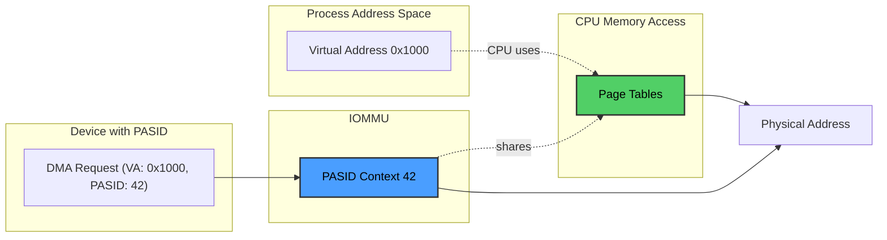
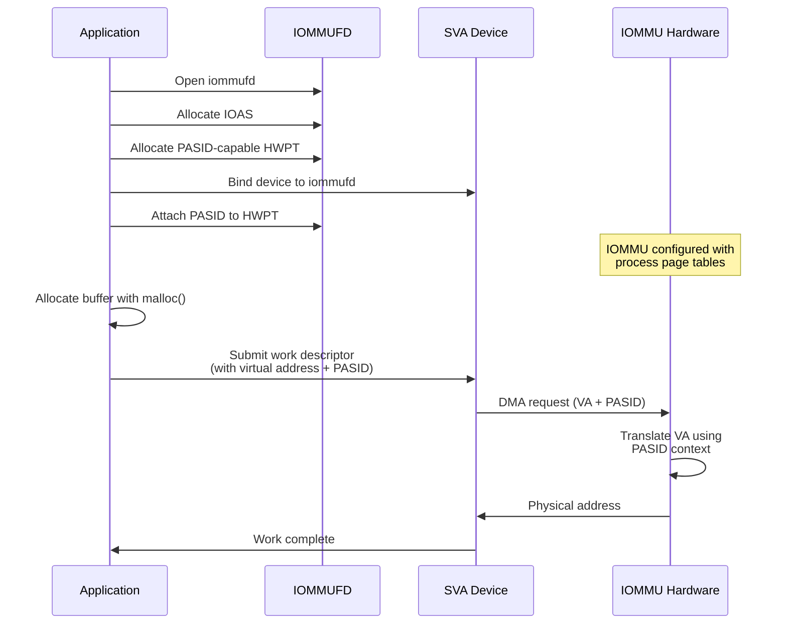

# PASID and Shared Virtual Addressing (SVA)

## What is PASID?

**PASID** (Process Address Space Identifier) is a 20-bit identifier defined by the PCIe specification that allows devices to distinguish between different address spaces. It enables a single physical device to simultaneously work with multiple processes, each identified by its unique PASID.

Key characteristics:

- **Per-Process Identification**: Each process gets a unique PASID when accessing SVA-capable devices
- **Hardware-Enforced Isolation**: The IOMMU uses PASID to enforce memory isolation between processes
- **Scalability**: Supports up to 2^20 (1,048,576) concurrent address spaces per device
- **Standard Compliance**: Part of the PCIe SIG specification, supported across vendors

## Shared Virtual Addressing (SVA)

SVA allows devices to directly use application virtual addresses without requiring software translation or memory pinning. This is achieved by having the IOMMU share the CPU's page tables with the device.



**Benefits of SVA:**

- **No Memory Pinning**: Pages can be swapped; the IOMMU handles page faults via PRI (Page Request Interface)
- **Direct Buffer Access**: Applications can pass `malloc()` pointers directly to devices
- **Simplified Programming**: No need for separate DMA buffer management
- **Efficient Memory Use**: Eliminates redundant data copies between CPU and device memory

## PASID with IOMMUFD

[IOMMUFD](./iommufd.md) provides comprehensive support for PASID-based operations, introduced in Linux kernel 6.2 and enhanced in subsequent releases.

### PASID Domain Allocation

IOMMUFD allows creating domains that support PASID attachment:

```c
#include <linux/iommufd.h>

// Allocate a PASID-capable HWPT
struct iommu_hwpt_alloc hwpt_req = {
    .size = sizeof(hwpt_req),
    .flags = IOMMU_HWPT_ALLOC_PASID,  // Request PASID support
    .dev_id = device_id,
    .pt_id = ioas_id,
};

if (ioctl(iommu_fd, IOMMU_HWPT_ALLOC, &hwpt_req) < 0) {
    perror("Failed to allocate PASID HWPT");
    return -1;
}

uint32_t hwpt_id = hwpt_req.out_hwpt_id;
uint32_t pasid_width = hwpt_req.out_capabilities;  // Width of PASID support
```

### PASID Attach and Detach (Kernel 6.8+)

Recent kernel versions (6.8+) added user-space APIs for attaching and detaching specific PASIDs:

```c
// Attach a PASID to an IOAS or HWPT
struct vfio_device_pasid_attach_iommufd_pt attach_req = {
    .argsz = sizeof(attach_req),
    .flags = 0,
    .pasid = 42,  // The PASID to attach
    .pt_id = ioas_id,  // IOAS or HWPT to attach to
};

if (ioctl(device_fd, VFIO_DEVICE_PASID_ATTACH_IOMMUFD_PT, &attach_req) < 0) {
    perror("Failed to attach PASID");
    return -1;
}

// Later, detach the PASID
struct vfio_device_pasid_detach_iommufd_pt detach_req = {
    .argsz = sizeof(detach_req),
    .flags = 0,
    .pasid = 42,
};

ioctl(device_fd, VFIO_DEVICE_PASID_DETACH_IOMMUFD_PT, &detach_req);
```

## SVA Workflow with IOMMUFD

The typical workflow for using SVA with IOMMUFD:



## PASID and Page Faults

When using SVA, pages don't need to be resident in memory. The IOMMU can handle page faults via PRI:

1. **Device Issues DMA**: Device attempts to access a virtual address with its PASID
2. **Page Fault**: If the page isn't resident, IOMMU generates a page fault
3. **Page Request**: IOMMU uses PRI to request the page from the CPU
4. **Page Mapping**: CPU brings the page into memory and updates page tables
5. **DMA Retry**: IOMMU retries the translation and completes the DMA

This mechanism is similar to CPU page faults and is handled transparently by the kernel.

## ENQCMD: Hardware-Accelerated Submission

On x86 platforms with Intel CPUs (Sapphire Rapids and later), the ENQCMD instruction provides atomic work submission with PASID:

```c
#include <x86intrin.h>

// Work descriptor structure (device-specific)
struct work_descriptor {
    uint64_t opcode;
    void *src_addr;      // Virtual address
    void *dst_addr;      // Virtual address
    size_t length;
    // ... other fields
};

// Submit work using ENQCMD
struct work_descriptor desc = {
    .opcode = COPY_OPERATION,
    .src_addr = source_buffer,  // Virtual address from malloc()
    .dst_addr = dest_buffer,    // Virtual address from malloc()
    .length = buffer_size,
};

// ENQCMD automatically includes the process's PASID
int status = _enqcmd(&device_portal, &desc);
if (status != 0) {
    // Submission failed (queue full, retry)
}
```

**ENQCMD Features:**

- Atomically writes descriptor and reads submission status
- Automatically includes IA32_PASID MSR value (set by kernel)
- Non-posted semantics: immediate feedback on success/failure
- User-mode instruction: no system call overhead

## Kernel Support Timeline

- **Linux 5.0-5.10**: Initial SVA infrastructure, IOMMU SVA API
- **Linux 6.2**: IOMMUFD introduced with PASID-capable HWPT support
- **Linux 6.8**: PASID attach/detach user-space APIs added
- **Linux 6.10+**: Enhanced PASID support for virtualization (VFIO PCI)

## Hardware Requirements for PASID/SVA

- **CPU**: Support for PASID MSR (IA32_PASID on x86)
- **IOMMU**: PASID support (Intel VT-d scalable mode, ARM SMMUv3 PASID extension)
- **Device**: PCIe PASID capability, ATS (Address Translation Services), PRI (Page Request Interface)
- **Platform**: PCIe root complex with PASID routing support

## Use Cases for PASID

1. **Multi-Process Acceleration**: Single accelerator serving multiple processes simultaneously
2. **Virtualization**: VM guests using PASID for nested SVA support
3. **Work Queues**: Dedicated work queues (DWQ) and shared work queues (SWQ) on Intel DSA/IAA
4. **GPU Compute**: Multiple processes submitting GPU work without driver mediation
5. **Storage Accelerators**: NVMe devices with multiple namespaces per process

## PASID vs. Traditional IOMMU Models

| Aspect | Traditional IOMMU | PASID/SVA |
|--------|------------------|-----------|
| **Address Space** | Device virtual addresses (IOVA) | Process virtual addresses |
| **Memory Pinning** | Required | Not required (on-demand paging) |
| **Programming Model** | DMA buffer allocation | Direct use of `malloc()` |
| **Context Switches** | Single device context | Multiple PASID contexts |
| **Page Faults** | Not supported | Handled via PRI |
| **Overhead** | Buffer mapping/unmapping | Minimal (shared page tables) |

## Related Topics

- [IOMMUFD](./iommufd.md) - Modern user space device access framework
- [VFIO](./vfio.md) - Virtual Function I/O framework
- [Linux UACCE](./uacce.md) - User Space Accelerator Framework
